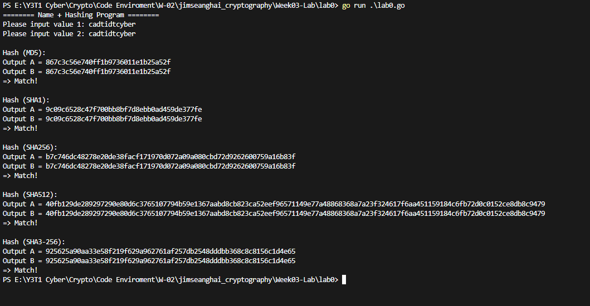
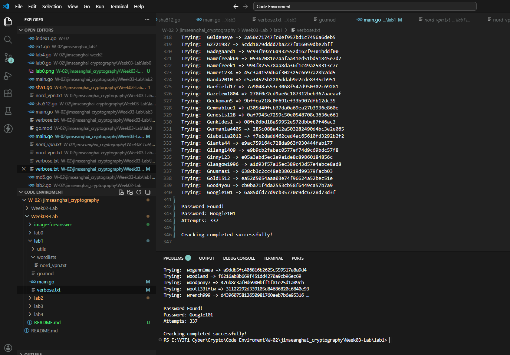
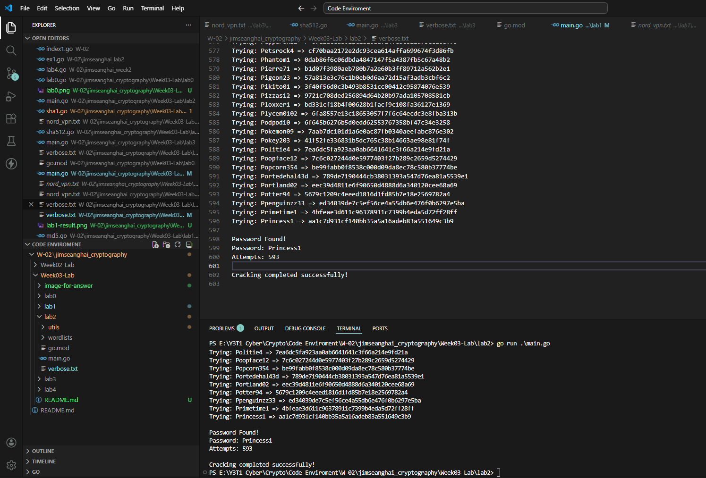
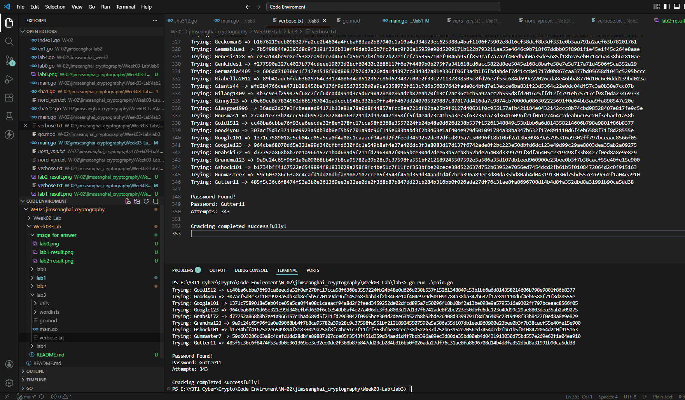
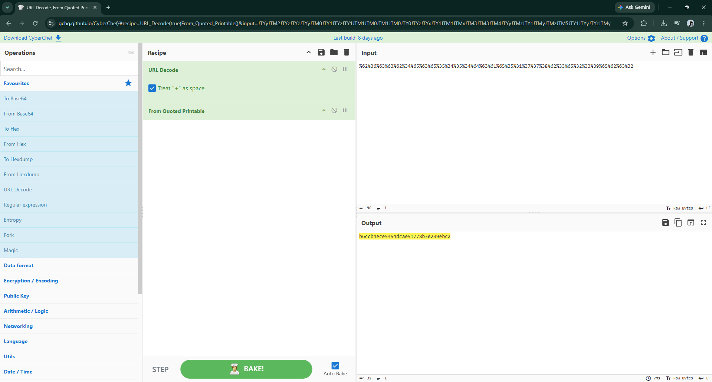
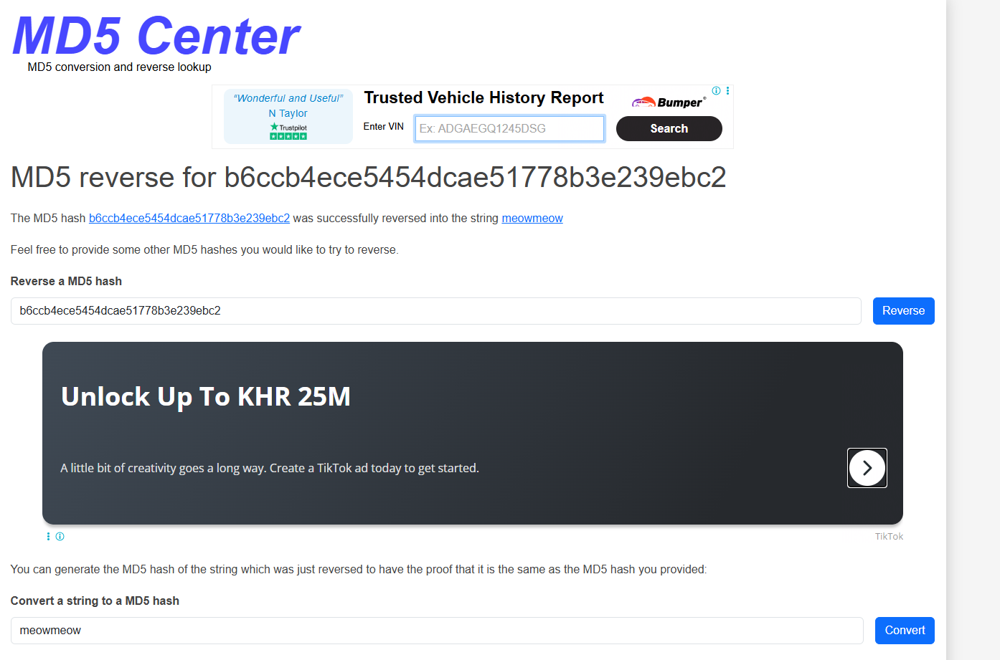
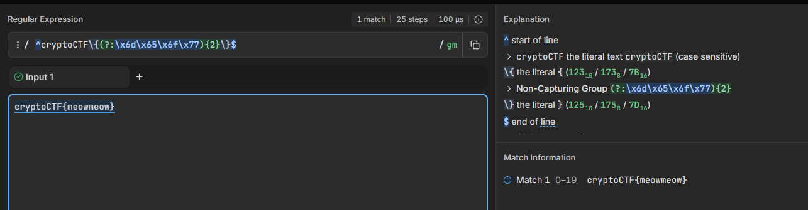

# Week 03 Lab - Hashing Cryptography

 Week 03 cryptography lab tasks and outputs.

## Lab Tasks & Results

## Lab 0

## Lab 1

## Lab 2

## Lab 3

## Lab 4

### Process
1. **Decode URL Hash:** Used CyberChef to decode/extract the hash from the URL.
   

2. **Crack MD5 Hash:** Used an MD5 lookup/reverse tool to crack the extracted hash, resulting in `meowmeow`.
   

3. **Format & Verify Answer:** Formatted the flag as `cryptoCTF{meowmeow}` and verified it against the given regex instruction `^cryptoCTF\{(?:\x6d\x65\x6f\x77){2}\}$`, confirming a match.
   

